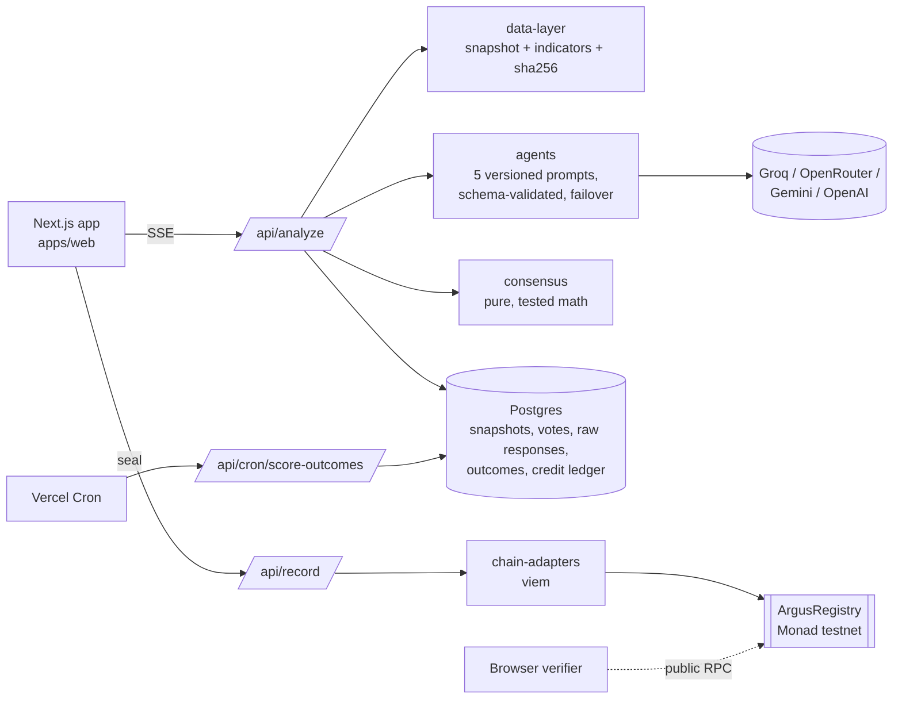

# Argus

**An AI investment committee you can audit.** Five independent LLM analysts — value, momentum, macro, on-chain and
risk — vote on a crypto asset from the same hashed market snapshot. Their votes are combined by a published formula,
and the decision, the data hash and the prompt hash are sealed on-chain. Every sealed decision gets a public page
that anyone can **re-verify in their browser**, and every analyst's track record is **scored against what the market
actually did**.

[](https://github.com/Shrysxs/Argus/actions/workflows/ci.yml)
· **Live:** [argus-web-beta.vercel.app](https://argus-web-beta.vercel.app) · Monad testnet · MIT

> Argus is a research and decision-support tool, not financial advice. See the [risk disclaimer](apps/web/app/legal/disclaimer/page.tsx).

---

## What makes it different

| | Typical "AI trading signal" | Argus |
|---|---|---|
| Who decides | One model, one prompt | Five analysts with distinct, versioned frameworks |
| Inputs | Unstated | One snapshot (price, ~210d technicals, sentiment), hashed and published |
| Bad model output | Patched or hidden | Rejected, retried once, then shown as a failure with the raw response kept |
| Missing data | Model guesses | Analyst abstains and says why |
| Proof | Screenshot | On-chain event + in-browser re-verification of every hash |
| Track record | Marketing | Each decision scored after 7 days; public leaderboard with Brier scores |

## Product tour

- **Workbench** (`/syndicate`) — pick from 100+ assets, run the committee and watch votes stream in over SSE, see
  quorum/split/degraded states, then seal with your own wallet or the Argus relayer.
- **Decision page** (`/d/:id`) — votes, reasoning, cited data, the raw snapshot, hashes, on-chain record, realized
  outcome, and a *Verify independently* button.
- **Public ledger** (`/decisions`) and **leaderboard** (`/leaderboard`).
- **Account** — credit balance, an append-only credit ledger, password change, sign-out-everywhere.
- **Methodology** (`/methodology`) — every formula and hash definition, written to match the code.

## Architecture



Design rules (enforced by structure, documented in [`AGENTS.md`](AGENTS.md)):

- Business logic never imports a chain SDK — everything on-chain goes through `ChainAdapter`.
- The consensus engine is pure: data in, decision out, no I/O, fully unit tested.
- Prompts are files, versioned, never edited in place; their SHA-256 is committed per vote.
- Fail loud: failures and abstentions are shown and stored, never silently dropped or replaced.
- The registry contract stores nothing, holds no funds and has no admin.

## How verification works

```text
dataSnapshotHash  = sha256(canonical(snapshot.data))                 ← stored verbatim, re-hashable
promptHash_i      = sha256(prompt file text)                         ← prompt texts served at /api/prompts
promptVersionHash = sha256(canonical({v:1, prompts:[{agentId, promptVersion, promptHash}]}))
reasoningHash     = sha256(canonical({v:1, snapshotHash, votes:[{agentId, vote, confidence, reasoning, dataPointsCited}]}))
on-chain          = DecisionRecorded(asset, decision, confidenceBps, dataSnapshotHash, promptVersionHash, ts, sender)
```

`canonical()` sorts object keys recursively. Client-signed seals are accepted only after the server decodes the
transaction's event and matches every field against the stored analysis.

## Getting started

Requirements: Node 22+, Postgres 14+, and at least one LLM API key (Groq has a free tier).

```bash
npm install
cp apps/web/.env.example apps/web/.env      # fill in DATABASE_URL, DIRECT_URL and an LLM key
cd apps/web
npx prisma migrate deploy                   # create the schema
npm run dev                                 # http://localhost:3000
```

### Upgrading an existing database (one-time)

Databases created before migrations existed (via `prisma db push`) must be baselined once:

```bash
cd apps/web
npx prisma migrate resolve --applied 0_init
npx prisma migrate deploy
```

On Vercel, `apps/web` uses the `vercel-build` script, which runs `prisma migrate deploy` before `next build` for **production** deployments only (previews never migrate). Until the
baseline above has been done, that build fails on purpose and Vercel keeps serving the previous deployment — it never
ships code against an un-migrated database.

Note: migration `6_hashed_session_tokens` signs everyone out once, and `5_credits_cents_ledger` converts balances to
integer cents with an opening-balance ledger entry per user.

### Production checklist

| Variable | Why |
|---|---|
| `COINGECKO_API_KEY` | keyless CoinGecko is rate limited from cloud IPs |
| `UPSTASH_REDIS_REST_URL` / `_TOKEN` | rate limits shared across serverless instances |
| `CRON_SECRET` | authenticates the daily outcome-scoring cron (`apps/web/vercel.json`) |
| `MONAD_SIGNER_PRIVATE_KEY` | enables relayer seals (testnet only — use a KMS/relayer for mainnet) |
| `NEXT_PUBLIC_APP_URL`, `COOKIE_SECURE=true` | canonical URLs and secure cookies |

See [`apps/web/.env.example`](apps/web/.env.example) for everything else.

## Testing

```bash
npx turbo typecheck lint
npx turbo test --filter=@argus/*            # pure package tests (no network)
cd apps/web && npm test                     # integration tests — needs DATABASE_URL
cd contracts && forge test
```

CI runs all of the above against a real Postgres service, checks the Prisma schema has no drift from the
migrations, builds the app, and runs Foundry fmt/build/test.

## Public API

| Endpoint | Description |
|---|---|
| `GET /api/decisions?asset=BTC&page=1` | Sealed decisions feed |
| `GET /api/decisions/:id` | Full record: votes, reasoning, canonical snapshot, hashes, seal payload |
| `GET /api/prompts?ref=momentum-trader/v3` | Exact prompt text (to recompute `promptHash`) |
| `GET /api/pricing/signal?id=:id` | Entropy-based information value quote (MATH.md §3) |
| `GET /api/health` | Liveness / database readiness |

Authenticated: `POST /api/analyze` (JSON or `Accept: text/event-stream`), `POST /api/record`, `/api/history`,
`/api/billing/*`, `/api/account/*`.

## Repository layout

```text
apps/web/               Next.js 16 app (App Router), API routes, Prisma schema + migrations
packages/agents/        roster, versioned prompts (bundled at build), runner, output validation, providers
packages/consensus/     consensus, outcome scoring, reputation, entropy pricing (pure math)
packages/data-layer/    market data fetchers + fallbacks, indicators, canonical hashing
packages/chain-adapters ChainAdapter, viem Monad adapter, browser adapter, tx verification
packages/shared-types/  cross-package contracts
packages/ui/            design tokens and primitives
contracts/              ArgusRegistry (Foundry)
```

Deeper docs: [`AGENTS.md`](AGENTS.md) (architecture constitution) · [`MATH.md`](MATH.md) · [`SYNDICATE.md`](SYNDICATE.md) ·
[`DATA.md`](DATA.md) · [`ONCHAIN.md`](ONCHAIN.md) · [`packages/ROADMAP.md`](packages/ROADMAP.md) ·
[`docs/agent-prompt-changelog.md`](docs/agent-prompt-changelog.md)

## Origin

Argus started as *Penguin Protocol* at Monad Blitz Pune and has since been rebuilt for production use.

## License

[MIT](LICENSE)
